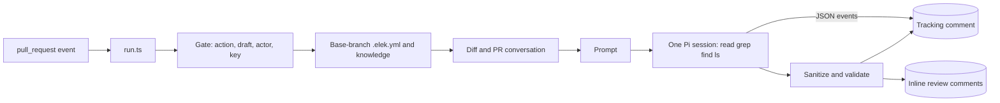

# Architecture

elek is a composite GitHub Action that wraps the Pi CLI. Each run reviews one
pull request in one read-only Pi session, and the host posts the result.

## Review flow



`src/entrypoints/run.ts` runs these steps:

1. Parse the inputs and the `pull_request` payload. Any other event ends the
   run as `skipped`.
2. Review only the `opened`, `synchronize`, `reopened`, and `ready_for_review`
   actions, and skip drafts.
3. Skip bots and actors who are not repository owners, members, or
   collaborators. A live permission lookup covers stale webhook data.
4. Check the provider key before any GitHub write. A fork PR without secrets
   ends as `skipped`. A same-repository run without a key fails and names the
   input to set.
5. Load `.elek.yml` and the knowledge files from `origin/<base branch>`. If
   that config cannot be loaded, use the checked-out `.elek.yml` and knowledge
   files.
6. Build the diff from the checkout, or fetch it from the GitHub API.
7. Create or reuse the tracking comment, then run Pi and stream progress into
   it.
8. Sanitize the final answer, post it with a token usage line, and post the
   findings as inline comments on changed lines.

The run succeeds only when Pi succeeds, the answer is a usable review, and
GitHub accepts it.

## Pi process

`src/pi.ts` starts Pi with these flags:

- `--mode json`
- `--no-session`
- `--no-skills`
- `--no-context-files`
- `--no-approve`
- `--no-mcp`
- `--no-extensions`
- `-e src/pi-workspace-guard.ts`
- `--tools read,grep,find,ls`
- `--append-system-prompt` with the read-only reviewer contract

The workspace guard blocks tool calls on paths outside the repository, `.git`,
secret files, and symlink escapes. The child process gets an environment
allowlist: locale, temp directories, Pi paths, and provider credentials. It
never gets `GITHUB_TOKEN`. elek closes Pi's standard input, because Pi waits on
an open stdin pipe in JSON mode.

The runner reads the final assistant message and sums the provider-reported
tokens across turns. When the provider reports no usage, it estimates tokens
from the prompt and output length. It retries once for a confirmed transport
failure and never for other failures. `run_timeout_seconds` stops a run that
takes too long.

## Prompt

`src/github/data.ts` builds the prompt. It wraps untrusted evidence in tags:
the PR title and body, the diff, PR comments, prior review comments, and the
base-branch config and knowledge. The trusted instructions follow:

- the review request, which is the `prompt` input or the default request;
- the review steps;
- the risk and design lenses and the validation pass, from
  `src/review/contract.ts`;
- the finding acceptance gates;
- the rule to leave review feedback only;
- the response format.

`src/review/diff-context.ts` fits the diff to the model's context budget. It
includes the full diff when it fits. Otherwise it keeps the file overview and
per-file slices.

## Public output

`src/review/public-output.ts` prepares the model answer for GitHub:

- removes research narration and delivery chatter;
- removes model-written run and token footers;
- redacts token-shaped secrets;
- rejects an empty answer and any merge-approval claim.

`src/review/findings.ts` parses the findings, and
`src/entrypoints/post-buffered.ts` posts the ones anchored to changed lines as
one grouped `COMMENT` review. A hidden marker on each inline comment lets the
next run skip findings that are already on the PR.

`src/github/comments.ts` owns the tracking comment. It reuses the newest
comment for the same provider and model, written by a trusted login, and marks
older ones as superseded.

## Security boundary

The model has read-only tools and no GitHub token. The host posts comments and
reviews with the `COMMENT` event. No code path approves, merges, closes, or
pushes. The workflow grants:

```yaml
permissions:
  contents: read
  pull-requests: write
  issues: write
```

## Main modules

| Module | Responsibility |
|---|---|
| `src/entrypoints/run.ts` | End-to-end run and GitHub delivery |
| `src/github/context.ts` | Inputs and the `pull_request` payload |
| `src/github/trigger.ts` | Which events and actors get a review |
| `src/credentials.ts` | Provider key check and fork skip |
| `src/config.ts` | `.elek.yml` parsing and base-branch loading |
| `src/github/data.ts` | Diff collection and the prompt |
| `src/review/contract.ts` | Review lenses and finding acceptance gates |
| `src/pi.ts` | Pi process, JSON events, token usage, typed failures |
| `src/pi-workspace-guard.ts` | Path guard for Pi's read-only tools |
| `src/review/public-output.ts` | Sanitizing and validating the review |
| `src/entrypoints/post-buffered.ts` | Inline comments on changed lines |
| `src/github/comments.ts` | Tracking comment and PR review |
